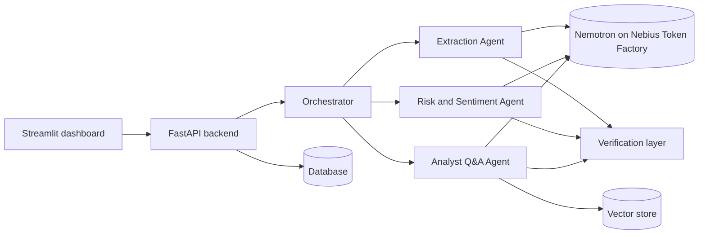

# Autonomous Financial Analyst & Earnings Call Intelligence Agent

Built for the Nebius x NVIDIA Global AI Hackathon. Upload an earnings-call transcript or an SEC filing (PDF, TXT or HTML) and a team of AI agents will:

- **Extract** key metrics (revenue, margins, operating income, net income, EPS, guidance) with the exact source quote for each number.
- **Analyze** risk and management tone, with a severity rating for every risk and evidence for every claim.
- **Answer questions** about the document with citations.
- **Compare** quarters, show trends, and write a one-click analyst brief.

Everything runs on NVIDIA Nemotron models served by Nebius Token Factory. The main idea is that **the model proposes and code verifies**: every number and quote is checked against the source text before it reaches the user.

**Demo recovery:** If the demo shows no documents (the free host resets its data after restarts), upload `data/sample/nvidia_Q4FY26_10K.pdf` and `data/demo/northwind_Q3FY26_call.txt` on the Upload page.

Live demo: https://financial-analyst-agent-v1.onrender.com (API docs at `/docs`)  <!-- keep only if the demo runs on permitted documents -->
Demo video: (YouTube link, added before submission)

## Architecture



1. **Ingestion** (backend): files are uploaded, parsed (transcripts are split into prepared remarks and Q&A; SEC filings into sections and tables), stored, chunked and embedded.
2. **Orchestrator** (`agents/orchestrator.py`): routes a document through extraction, analysis and Q&A.
3. **Agents** (`agents/`): extraction (`extraction_agent.py`, `extract_filing.py`), risk and sentiment (`risk.py`, `risk_judge.py`, `sentiment.py`, `hedging.py`), Q&A with citations (`analyst.py`, `retrieval.py`), brief and trends (`brief.py`, `trends.py`).
4. **Verification layer** (`verify.py`, `verify_source.py`, `ground.py`): code checks on every model output (see "Reliability" below).
5. All model output is validated against Pydantic schemas (`agents/schemas.py`), with automatic retries on invalid JSON.


## How we use NVIDIA Nemotron and Nebius Token Factory
- All LLM calls go through Nebius Token Factory (OpenAI-compatible API). Default model: nvidia/NVIDIA-Nemotron-3-Nano-30B-A3B, with reasoning turned off for fast, structured JSON.
- We benchmarked 5 models on the same 4 documents (23 values): see docs/benchmark_report.md.

| Model | Perfect runs (23/23) | Time per run | Approx. cost per run |
|---|---|---|---|
| Nemotron 3 Nano 30B (chosen) | 5 of 5 | 28 to 48 s | $0.005 to $0.007 |
| Nemotron 3 Super 120B | 4 of 4 | 29 to 34 s | about $0.023 |
| Nemotron 3.5 Lightning | 1 of 4 | 29 to 62 s | n/a |
| Qwen3-30B Instruct | 1 of 1 | 482 s | about $0.014 |
| gpt-oss-120b | 0 of 1 (19/23) | 41 s | about $0.018 |

Why Nano: same accuracy as the larger Nemotron model at roughly one third to one fifth of the cost per run.
Honest limits: small test, prompts tuned on Nemotron Nano, one to five runs per model.

## Reliability and evaluation
We do not trust the model alone. Checks run in code after every model call:
1. Every extracted number must appear in the source text next to its label, or it is dropped.
2. Impossible values are fixed or dropped (for example, a percent above 100).
3. Every quote used as evidence must exist in the document; a second pass rejects quotes that do not support the claim.
4. Unsupported claims are downgraded; if no risk can be verified, the rating is "unknown", never "low".
5. Hedging language is measured by counting phrases in code, not by asking the model.

| Test | Result |
|---|---|
| Extraction accuracy, 5 documents, 28 values | 28/28 correct, 0 hallucinated, 0 wrong, 0 missing |
| Quotes found verbatim in the source | 13 to 17 of 22 across runs (weakest on PDFs) |
| Where the 22 extracted values come from (latest run) | 10 from Nemotron, 12 from the table and transcript fallback (a hybrid system) |
| Repeat runs on the same call (risk rating) | identical "high" in 6 of 6 runs; tone and hedging identical |
| Hosted smoke test (9 endpoints) | 9/9 passing |
| Hosted Q&A, 9-question starter set on the 10-K, 3 runs on the latest images | 9/9 correct in every run; 13/13, 11/11 and 14/14 checked citations found in the source; the unanswerable question abstained each time |
| Q&A, 20-question set (18 on the 10-K, 2 on a fictional call), repeated runs on the hosted and local backend | 13 to 17 of 20 correct across runs and code versions (automatic matching); strict manual grading was 16/20 in one run; 3/3 unanswerable questions refused; every checkable citation was found in the source (15/15 to 24/24 per run). Weak spots: derived percentages (margins) are often refused, one answer used the wrong unit, and one question sometimes returns the wrong line item (see docs/bug_list.md) |
| Invalid-input requests to /chat (6 cases) | 6/6 return structured errors |

Limits: the 5 documents are all from NVIDIA and were used while tuning the prompts, so scores are optimistic. The Q&A sets are small (9 and 20 questions, mostly on one document), so results are indicative, not a benchmark. Details: docs/verification_report.md, docs/stability_report.md.

## Run it

You need Python 3.11+ and a Nebius Token Factory API key.

```bash
git clone <this repo> && cd <repo folder>
python3 -m venv .venv && source .venv/bin/activate
pip install -r backend/requirements.txt
cp .env.example .env        # then set NEBIUS_API_KEY
cd backend && uvicorn app.main:app --reload
```

Open http://127.0.0.1:8000/docs.

**With Docker (recommended):** the compose file builds from the project root so `agents/` is included. Run `cp .env.example .env`, set `NEBIUS_API_KEY`, then `docker compose up --build` and open http://127.0.0.1:8000/docs. The database and uploads are kept in a Docker volume, so they survive restarts.

Settings (environment variables): `NEBIUS_API_KEY` (required), `NEBIUS_MODEL` (optional, default `nvidia/NVIDIA-Nemotron-3-Nano-30B-A3B`), `NEBIUS_THINKING` (`on` to enable the model's reasoning mode; default off).

**Dashboard (Streamlit):** the dashboard is a separate small app that talks to the backend API.
1. Start the backend first (the Docker or uvicorn steps above), so http://127.0.0.1:8000 answers.
2. In a second terminal, install the dashboard packages: `pip install -r frontend/requirements.txt`
3. Start the dashboard: `streamlit run frontend/upload.py`
4. Open http://localhost:8501 and use the pages Upload, Analysis and Chat.
5. To point the dashboard at a different backend, set the address first: `FINANCIAL_ANALYST_API_URL=https://your-backend-url streamlit run frontend/upload.py`

The dashboard reads `FINANCIAL_ANALYST_API_URL` and defaults to `http://127.0.0.1:8000`.

Sample documents are not included for licensing reasons. Use any public earnings-call transcript or SEC 10-K/10-Q (public filings are available on sec.gov) in PDF, TXT or HTML.

## API

| Endpoint | What it does |
|---|---|
| `POST /upload` | Upload and index a document |
| `GET /documents`, `GET /documents/{id}` | List documents or read one |
| `POST /extract/{id}` | Extract metrics and guidance |
| `GET /documents/{id}/metrics` | Read stored metrics |
| `POST /analyze/{id}`, `GET /jobs/{job_id}` | Risk and sentiment analysis as a background job |
| `GET /documents/{id}/analysis` | Read the latest analysis |
| `POST /chat`, `GET /chat/{conversation_id}` | Ask questions with citations |
| `GET /companies`, `GET /metrics`, `GET /compare` | Query and compare records across quarters |
| `GET /trends` | Cross-quarter trends |
| `POST /brief/{id}` | One-click analyst brief |
| `GET /health` | Health check |

## Tests and evaluation

```bash
pytest                                  # backend tests
python scripts/contract_test.py         # agent contract tests
python3 -m scripts.eval_extraction      # extraction accuracy against hand-made answer keys
python3 -m scripts.benchmark_models     # model benchmark on Token Factory
python scripts/stability_check.py 2 3   # repeat-run stability on a hosted document
python scripts/hosted_smoke.py          # smoke test of the hosted endpoints
```

## Repo layout

- `agents/`   AI agents, prompts, verification, evaluation answer keys
- `backend/`  FastAPI service (ingestion, parsing, database, vector store, API)
- `frontend/` Streamlit dashboard
- `scripts/`  Tests, evaluation, benchmark, smoke test, demo seeding
- `docs/`     Architecture, API contract, evaluation and benchmark reports

## Limitations
- The Q&A evaluation set is small (20 questions, two documents, drafted by the team lead with AI assistance and checked against the sources); results are indicative, not a benchmark.
- All evaluation documents are NVIDIA filings and calls, used while tuning the prompts, so results are optimistic for other companies.
- About half of the extracted headline values come from a code fallback (table rows and transcript sentences), not from the model alone.
- The model sometimes returns badly formatted JSON; retries and a double-check before abstaining reduce false abstains but do not remove them.
- Hedging bands are provisional, tuned on 3 NVIDIA calls; PDF and text versions of the same call score slightly differently.
- The hosted demo runs on a free tier and may sleep or reset its data.

## Team

Bhavana (lead, AI agents, evaluation), Sandeep (backend, ingestion, deployment), Alekhya (dashboard, sample data, demo).

## License

MIT, see [LICENSE](LICENSE).
